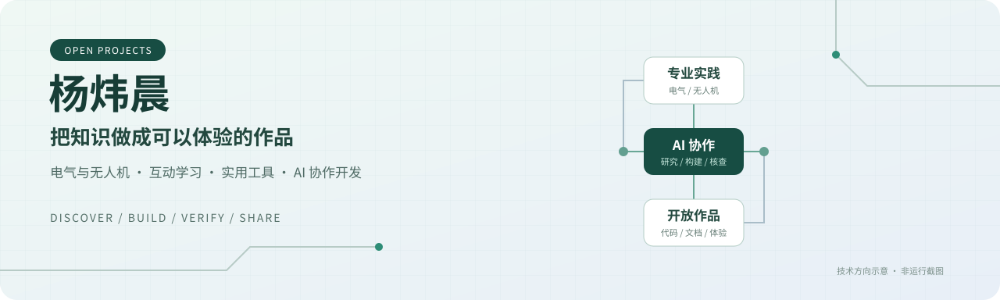
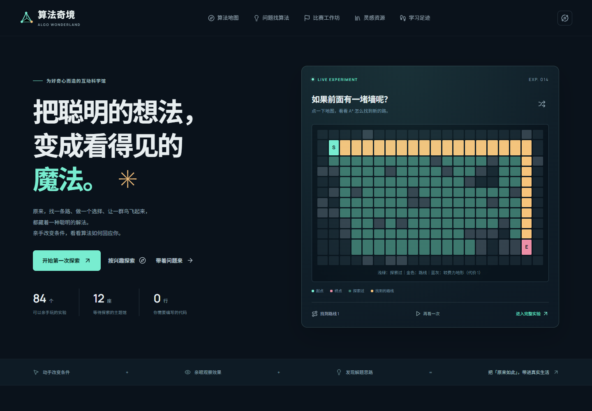

# 你好，我是杨炜晨

**电气工程及其自动化本科生 · 无人机教育实践 · AI 协作开发**

就读于**广州科技职业技术大学 · 人工智能与大数据学院**，2024 年入学，预计 2028 年毕业。我喜欢把专业知识做成能操作、能解释、能验证的作品：从算法互动体验，到个人工具、教育网站与硬件原型。

在 AI 协作项目中，我主要负责**需求调研、整体策划、任务拆解、提示词设计和交付检查**；具体技术实施与协作边界见各项目文档。当前职业探索方向是电力场景无人机技术销售，并拓展英语技术表达与海外业务能力。

[算法奇境当前在线体验](https://yangwei251003.github.io/algorithm-wonderland/) · [全部公开仓库](https://github.com/yangwei251003?tab=repositories)

历史画面：算法奇境第一版；当前线上为2.0审查版。点击截图打开当前版本，功能与审查范围以当前项目说明为准。

## 项目导航

每个仓库记录自己的源码、运行步骤、真实配图、验证范围与许可。网页入口可能是完整交互界面，也可能是合成案例或安装导览；动态后端、硬件和本机工具按各自README运行。第三方改编和本地兼容分支保留上游归属。

| 代表实践 | 内容与边界 | 入口 |
|---|---|---|
| **算法奇境** | 当前2.0审查版已有Pages交互预览；V1兼容入口跳转至当前版，旧产物按标签保留 | [当前体验](https://yangwei251003.github.io/algorithm-wonderland/) · [源码](https://github.com/yangwei251003/algorithm-wonderland) |
| **纸上有数** | 剪纸结构与几何实验，含作品保存和纸样导出 | [仓库](https://github.com/yangwei251003/zhishang-youshu) |
| **余烬灯塔** | MIT上游改编的中文塔防与简化微电网预算；不是工程电网仿真 | [直接游玩](https://yangwei251003.github.io/last-beacon-complete/) · [源码与归属](https://github.com/yangwei251003/last-beacon-complete) |
| **巡点** | STM32与ESP协作巡检研究原型，硬件和实际场景验证范围另列 | [源码与复现说明](https://github.com/yangwei251003/active-inspection) |

以下按用途整理当前已存在的公开仓库；同项目历史分支放回原仓，私有资料与未完成来源核对的安装包不作为公开作品。其余本地项目仍在迁移，目录会持续补齐。

<strong>Skill、插件与适配 · 32 个仓库</strong>

| 项目 | 当前用途 | 入口 |
|---|---|---|
| `agent-work-boundaries` | Agent 工作边界：项目记录、交接摘要与独立协作的可核验工作流。 | [源码](https://github.com/yangwei251003/agent-work-boundaries) |
| `ai-super-image-art-director` | AI美术流程Skill：53风格标签检索、提示词构建、QA状态与PNG导出，附真实离线合成演示；生图依赖宿主工具。 | [源码](https://github.com/yangwei251003/ai-super-image-art-director) · [网页 / 导览](https://yangwei251003.github.io/ai-super-image-art-director/) |
| `asset-reverse-engineer-skill` | 素材结构化拆解工作流Skill，保留证据、来源与重建边界。 | [源码](https://github.com/yangwei251003/asset-reverse-engineer-skill) |
| `batch-file-processor` | 批量文件处理工作流Skill，范围预览、转换工具选择与执行后复核。 | [源码](https://github.com/yangwei251003/batch-file-processor) |
| `cli-anything-local` | CLI工具发现与构建的定制入口Skill，不捆绑第三方软件。 | [源码](https://github.com/yangwei251003/cli-anything-local) |
| `codex-computer-operator` | Codex 电脑操作入口：能力检查、状态核对与操作验证的本地 Skill。 | [源码](https://github.com/yangwei251003/codex-computer-operator) |
| `competition-form-autofill` | 比赛材料填写工作流Skill，依赖宿主文档能力，不捆绑个人报名资料。 | [源码](https://github.com/yangwei251003/competition-form-autofill) |
| `deepseek-harness-local-toolkit` | DeepSeek Harness本机启动、导入、诊断与模式Skill，附隔离fixture和可移植配置说明。 | [源码](https://github.com/yangwei251003/deepseek-harness-local-toolkit) |
| `dsh-polyglot-compat` | DSH多模型插件兼容分支，保留Jesse-njx上游MIT与prepareCall回环验证。 | [源码](https://github.com/yangwei251003/dsh-polyglot-compat) |
| `dsh-skin-local` | DSH皮肤模块本地定制：16色板与独立模块预览，保留KinGao294上游归属。 | [源码](https://github.com/yangwei251003/dsh-skin-local) · [网页 / 导览](https://yangwei251003.github.io/dsh-skin-local/) |
| `dynamic-skill-router` | 动态技能路由器：基于任务发现Skill、MCP与插件建议，附隔离示例和stdio服务。 | [源码](https://github.com/yangwei251003/dynamic-skill-router) |
| `dynamic-skill-router-plugin` | Codex动态技能路由器插件：便携入口、配置示例与隐私友好的依赖检查。 | [源码](https://github.com/yangwei251003/dynamic-skill-router-plugin) |
| `easyeda-local-mcp-adapter` | 嘉立创EDA专业版本地Bridge的非官方Python MCP适配器，提供隔离测试与接入说明。 | [源码](https://github.com/yangwei251003/easyeda-local-mcp-adapter) |
| `homepage-skill-windows-fixes` | Personal Homepage Skill 的两项 Windows 换行与路径修补；保留上游非商业许可。 | [源码](https://github.com/yangwei251003/homepage-skill-windows-fixes) |
| `math-modeling-pipeline-master` | 数学建模阶段清单与历史技能映射参考，外部工具按需核实。 | [源码](https://github.com/yangwei251003/math-modeling-pipeline-master) |
| `math-modeling-super-brain` | 数学建模任务工作流与本地Skill分类扫描器，附原创隔离示例。 | [源码](https://github.com/yangwei251003/math-modeling-super-brain) |
| `omnimodal-prompt-architect-skill` | 多模态提示词设计与检查工作流Skill，附完整本地参考。 | [源码](https://github.com/yangwei251003/omnimodal-prompt-architect-skill) |
| `on-demand-tools` | Windows配置开关与恢复记录工具，附可移植Skill和隔离示例。 | [源码](https://github.com/yangwei251003/on-demand-tools) |
| `plainspoken-undercurrent` | 中文叙事修订Skill与零依赖表层文本分析器，保留事实和创作边界。 | [源码](https://github.com/yangwei251003/plainspoken-undercurrent) |
| `rea-local` | REA发布程序取证分析的定制入口Skill，保留官方能力与授权边界。 | [源码](https://github.com/yangwei251003/rea-local) |
| `resumecraft-skill` | 职业材料工作流与本地Word排版，附虚构示例及完整Python/Node源码。 | [源码](https://github.com/yangwei251003/resumecraft-skill) |
| `rural-revitalization-analysis` | 乡村振兴统计分析备忘Skill，字段约定与历史方法记录。 | [源码](https://github.com/yangwei251003/rural-revitalization-analysis) |
| `skill-orchestration-brain` | WorkBuddy历史技能分类与编排工作流，按当前宿主核实能力。 | [源码](https://github.com/yangwei251003/skill-orchestration-brain) |
| `vibe-product-director-skill` | 产品开发导演工作流，保全2.0至2.2版本、打包安装工具与原有校验。 | [源码](https://github.com/yangwei251003/vibe-product-director-skill) |
| `video-link-reader` | 视频证据读取Skill与Python分析器，附原创视频和真实抽帧OCR演示。 | [源码](https://github.com/yangwei251003/video-link-reader) |
| `wechat-article-reader` | 微信文章读取工作流与可移植MCP客户端，附合成本地传输示例。 | [源码](https://github.com/yangwei251003/wechat-article-reader) |
| `weekly-inspiration` | 手动发起的每周项目灵感与旧项目复查Skill，个人状态留在本地。 | [源码](https://github.com/yangwei251003/weekly-inspiration) |
| `weixin-reader-mcp-local` | Bwkyd微信阅读MCP本机兼容分支，保留MIT/Apache归属，附离线stdio验证与安装导览。 | [源码](https://github.com/yangwei251003/weixin-reader-mcp-local) · [网页 / 导览](https://yangwei251003.github.io/weixin-reader-mcp-local/) |
| `windows-font-audit` | Windows 字体审计与清理辅助：只读报告、受控预览与备份验证。 | [源码](https://github.com/yangwei251003/windows-font-audit) |
| `xiaozhixixi-dev-guardian` | 小智析析定制开发守门插件：调研与工具映射预检、阶段证据记录、Progress交接；含可运行合成CLI演示。 | [源码](https://github.com/yangwei251003/xiaozhixixi-dev-guardian) · [网页 / 导览](https://yangwei251003.github.io/xiaozhixixi-dev-guardian/) |
| `zhiying-site-builder` | 职映求职网站从需求到交付的开发工作流Skill与阶段模板。 | [源码](https://github.com/yangwei251003/zhiying-site-builder) |
| `zhiying-webdev-skill` | 职映网站开发状态机原型Skill，完整保留源码和未实现范围。 | [源码](https://github.com/yangwei251003/zhiying-webdev-skill) |

<strong>工具与应用 · 7 个仓库</strong>

| 项目 | 当前用途 | 入口 |
|---|---|---|
| `campus-material-toolkit` | 校园物料工具集：海报打包、图片目录、PDF及DOCX生成，以合成素材展示可运行流程。 | [源码](https://github.com/yangwei251003/campus-material-toolkit) · [网页 / 导览](https://yangwei251003.github.io/campus-material-toolkit/) |
| `document-production-toolkit` | 文档制作工具箱：保全55份历史程序，使用合成资料重现DOCX、XLSX与Markdown子流程。 | [源码](https://github.com/yangwei251003/document-production-toolkit) · [网页 / 导览](https://yangwei251003.github.io/document-production-toolkit/) |
| `document-reconciliation-study` | 单据文本与版式源码研究：8份历史程序替换私密常量，附可独立运行的中文数字解析示例。 | [源码](https://github.com/yangwei251003/document-reconciliation-study) |
| `jianzuo-workbench` | 简作本地运营工作台：完整Web/API/模拟站/扩展源码、审批与任务队列。 | [源码](https://github.com/yangwei251003/jianzuo-workbench) · [网页 / 导览](https://yangwei251003.github.io/jianzuo-workbench/) |
| `jobpilot` | 本地岗位匹配工作台：FastAPI/SQLite、规则分析与浏览器界面，默认离线。 | [源码](https://github.com/yangwei251003/jobpilot) · [网页 / 导览](https://yangwei251003.github.io/jobpilot/) |
| `presentation-delivery-toolkit` | 演示文稿交付脚本档案：多轮排版与审查源码，附标准库源码ZIP及逐成员完整性校验。 | [源码](https://github.com/yangwei251003/presentation-delivery-toolkit) |
| `windows-maintenance-script-archive` | Windows维护脚本档案：历史源码保全、机器常量脱敏，提供可直接运行的只读目录盘点。 | [源码](https://github.com/yangwei251003/windows-maintenance-script-archive) |

<strong>数据与研究 · 5 个仓库</strong>

| 项目 | 当前用途 | 入口 |
|---|---|---|
| `evigate` | EviGate：研究来源、阶段、运行记录与论断引用的证据验证器。 | [源码](https://github.com/yangwei251003/evigate) |
| `nengce-pilot` | 能策Pilot：可复现的能源策略研究工作台，公开数据与冻结证据独立校验。 | [源码](https://github.com/yangwei251003/nengce-pilot) · [网页 / 导览](https://yangwei251003.github.io/nengce-pilot/) |
| `powerlinebench` | PowerLineBench：输电巡检虚拟试验研究框架与协议检查器，规划器开发中。 | [源码](https://github.com/yangwei251003/powerlinebench) |
| `rural-revitalization-research` | 乡村振兴历史研究软件归档与合成流程演示，明确保留旧结果未复原等限制。 | [源码](https://github.com/yangwei251003/rural-revitalization-research) · [网页 / 导览](https://yangwei251003.github.io/rural-revitalization-research/) |
| `water-quality-modeling-study` | 水质分析与预测练习：19份历史源码、合成数据可运行通路及真实诊断图；非水安全结论。 | [源码](https://github.com/yangwei251003/water-quality-modeling-study) |

<strong>游戏、三维与动效 · 5 个仓库</strong>

| 项目 | 当前用途 | 入口 |
|---|---|---|
| `ai3d-future-courtyard` | 低多边形未来庭院：同一GLB的Blender源、Godot第三人称与Three.js交互查看器。 | [源码](https://github.com/yangwei251003/ai3d-future-courtyard) · [网页 / 导览](https://yangwei251003.github.io/ai3d-future-courtyard/) |
| `framefields-motion-demo` | 两段代码驱动动效：TypeScript/WebGPU原生渲染与程序配乐，附可直接播放成片。 | [源码](https://github.com/yangwei251003/framefields-motion-demo) · [网页 / 导览](https://yangwei251003.github.io/framefields-motion-demo/) |
| `last-beacon-complete` | 余烬灯塔：MIT上游改编、离线中文塔防与微电网游戏，保全两份本地源码历史。 | [源码](https://github.com/yangwei251003/last-beacon-complete) · [网页 / 导览](https://yangwei251003.github.io/last-beacon-complete/) |
| `low-altitude-twin-pulse` | 低空小队：两界共脉，Godot开发中游戏、完整公开源码与可校验资源附件。 | [源码](https://github.com/yangwei251003/low-altitude-twin-pulse) · [网页 / 导览](https://yangwei251003.github.io/low-altitude-twin-pulse/) |
| `polyforge-local` | PolyForge 本地兼容派生：参数化模型、Windows 原生工具修复与可旋转示例。 | [源码](https://github.com/yangwei251003/polyforge-local) · [网页 / 导览](https://yangwei251003.github.io/polyforge-local/) |

<strong>硬件与嵌入式 · 6 个仓库</strong>

| 项目 | 当前用途 | 入口 |
|---|---|---|
| `8051-led-chaser` | AT89C51流水灯课堂：两份C固件、可编辑电路、Keil采样与单向ngspice负载模型。 | [源码](https://github.com/yangwei251003/8051-led-chaser) · [网页 / 导览](https://yangwei251003.github.io/8051-led-chaser/) |
| `8051-two-digit-counter` | 8051双位数码管计数器：C51源码、Proteus工程和可复现编译，实板待验证。 | [源码](https://github.com/yangwei251003/8051-two-digit-counter) |
| `active-inspection` | 巡点：STM32与ESP协作的主动巡检研究原型，包含固件、硬件设计和本地复现说明。 | [源码](https://github.com/yangwei251003/active-inspection) · [网页 / 导览](https://yangwei251003.github.io/active-inspection/) |
| `phyllotaxis` | PHYLLO叶序灯：F411固件、网页演示与可公开硬件设计，实板尚未验证。 | [源码](https://github.com/yangwei251003/phyllotaxis) · [网页 / 导览](https://yangwei251003.github.io/phyllotaxis/) |
| `stm32f103-classroom-labs` | STM32F103课堂代码、原始快照和两份最小可链接例程，SDK外置，实板待验证。 | [源码](https://github.com/yangwei251003/stm32f103-classroom-labs) |
| `tia-portal-v17-local` | TIA Portal V17 MCP 本地派生：C#扩展、离线HMI检查与安装指南，需自备西门子环境。 | [源码](https://github.com/yangwei251003/tia-portal-v17-local) · [网页 / 导览](https://yangwei251003.github.io/tia-portal-v17-local/) |

<strong>网页与互动 · 36 个仓库</strong>

| 项目 | 当前用途 | 入口 |
|---|---|---|
| `aether-null` | AETHER//NULL：可离线构建的3D数字艺术体验，含着色器、交互音频与七章叙事。 | [源码](https://github.com/yangwei251003/aether-null) · [网页 / 导览](https://yangwei251003.github.io/aether-null/) |
| `aippt-studio` | AI演示工作台：编辑器、API、Worker与可复现的PPTX/PDF/PNG导出。 | [源码](https://github.com/yangwei251003/aippt-studio) · [网页 / 导览](https://yangwei251003.github.io/aippt-studio/) |
| `algorithm-wonderland` | 算法奇境：84项中文算法原理实验、252张科普漫画、Manim制作源码与Remotion交互；2.0审查版开源项目 | [源码](https://github.com/yangwei251003/algorithm-wonderland) · [网页 / 导览](https://yangwei251003.github.io/algorithm-wonderland/) |
| `algorithm-wonderland-site` | 原V1构建产物与兼容跳转入口；当前main转向2.0，V1原产物按标签保留。 | [源码](https://github.com/yangwei251003/algorithm-wonderland-site) · [网页 / 导览](https://yangwei251003.github.io/algorithm-wonderland-site/) |
| `animal-world-cup` | Animal World Cup：基于Apache开源项目的动物足球观赛与联机游戏工程。 | [源码](https://github.com/yangwei251003/animal-world-cup) · [网页 / 导览](https://yangwei251003.github.io/animal-world-cup/) |
| `brainboost` | BrainBoost：八种浏览器小游戏与本地示例问答，离线资源与训练记录。 | [源码](https://github.com/yangwei251003/brainboost) · [网页 / 导览](https://yangwei251003.github.io/brainboost/) |
| `brainboost-flutter` | Flutter初始化计数器骨架，完整平台源码与真实Web预览；独立于同名Vite脑训练游戏。 | [源码](https://github.com/yangwei251003/brainboost-flutter) · [网页 / 导览](https://yangwei251003.github.io/brainboost-flutter/) |
| `carbonpie` | 碳果派：Expo/React Native低碳记录、像素家园与独立微信原型，默认本机离线体验。 | [源码](https://github.com/yangwei251003/carbonpie) · [网页 / 导览](https://yangwei251003.github.io/carbonpie/) |
| `career-workbench` | 职业发展工作台：本地成果证据、事实核验、决策复盘与40张项目蓝图，附静态阅读体验。 | [源码](https://github.com/yangwei251003/career-workbench) · [网页 / 导览](https://yangwei251003.github.io/career-workbench/) |
| `client-intelligence-platform` | 客户资讯平台定制Skill：从需求到本地资讯网站的工作流与交付资料预检。 | [源码](https://github.com/yangwei251003/client-intelligence-platform) |
| `gridwatch` | 灯塔电网：配电约束塔防，原生Canvas、合成音效和离线单文件。 | [源码](https://github.com/yangwei251003/gridwatch) · [网页 / 导览](https://yangwei251003.github.io/gridwatch/) |
| `human-ai-open-worlds` | Human × AI：七世界个人站模板，含示例身份、静态预览与同项目历史检查点。 | [源码](https://github.com/yangwei251003/human-ai-open-worlds) · [网页 / 导览](https://yangwei251003.github.io/human-ai-open-worlds/) |
| `lingualens` | Chrome/Edge MV3英语学习侧栏：字幕跳转循环、双语学习与本地复习；附源码构建、合成回归与明确服务边界。 | [源码](https://github.com/yangwei251003/lingualens) |
| `liuzu-cloud-map` | 六祖云游地图与三端开发线：Next.js/公开GIS资料/候选行程，附可交互静态预览。 | [源码](https://github.com/yangwei251003/liuzu-cloud-map) · [网页 / 导览](https://yangwei251003.github.io/liuzu-cloud-map/) |
| `liuzu-cloud-tour` | 六祖云游：React/Vite旅游演示与本地后台，含真实静态交互入口。 | [源码](https://github.com/yangwei251003/liuzu-cloud-tour) · [网页 / 导览](https://yangwei251003.github.io/liuzu-cloud-tour/) |
| `mapcatbox-app` | MapCatBox Next.js 本地离线原型：合成猫咪地图、养成和资料保存；云端与定位仍开发中。 | [源码](https://github.com/yangwei251003/mapcatbox-app) · [网页 / 导览](https://yangwei251003.github.io/mapcatbox-app/) |
| `mapcatbox-local` | MapCat本地猫地图原型：合成地点、点赞评论与本地保存，默认不请求定位。 | [源码](https://github.com/yangwei251003/mapcatbox-local) · [网页 / 导览](https://yangwei251003.github.io/mapcatbox-local/) |
| `penguin-reflection-lab` | 企鹅学习联想：4页静态创作原型，默认合成输入与本机规则；非诊断工具，可选个人后端另配。 | [源码](https://github.com/yangwei251003/penguin-reflection-lab) · [网页 / 导览](https://yangwei251003.github.io/penguin-reflection-lab/) |
| `personal-brand-website` | 独立长主页Hero原型，保留占位内容与开发中状态、可复现静态预览。 | [源码](https://github.com/yangwei251003/personal-brand-website) · [网页 / 导览](https://yangwei251003.github.io/personal-brand-website/) |
| `personal-portfolio-lite` | 个人作品导航：轻量静态主页与保留性能观测源码的早期内联版本。 | [源码](https://github.com/yangwei251003/personal-portfolio-lite) · [网页 / 导览](https://yangwei251003.github.io/personal-portfolio-lite/) |
| `real-world-learning-mentor` | 真实项目学习导师Skill，附状态脚本、完整原有测试与研究来源。 | [源码](https://github.com/yangwei251003/real-world-learning-mentor) |
| `resilience-atlas` | 百折万象：七世界个人站模板，明确示例履历与AI素材，并保留同项目历史检查点。 | [源码](https://github.com/yangwei251003/resilience-atlas) · [网页 / 导览](https://yangwei251003.github.io/resilience-atlas/) |
| `shukan-city-explorer` | 数瞰城市：城市指标与三维地图研究源码，Pages使用明确标注的合成数据演示。 | [源码](https://github.com/yangwei251003/shukan-city-explorer) · [网页 / 导览](https://yangwei251003.github.io/shukan-city-explorer/) |
| `stm32-ai-mentor` | STM32项目学习导师Skill，完整软件测试、模板与空状态入口。 | [源码](https://github.com/yangwei251003/stm32-ai-mentor) |
| `stm32-learning-workbench` | 单文件STM32学习笔记工作台，支持项目、打卡、收藏和本地备份恢复。 | [源码](https://github.com/yangwei251003/stm32-learning-workbench) · [网页 / 导览](https://yangwei251003.github.io/stm32-learning-workbench/) |
| `twilight-gilded-portfolio` | 暮色金工：独立Hero与持久化设计Studio，静态导出、原型内容与组件许可明确。 | [源码](https://github.com/yangwei251003/twilight-gilded-portfolio) · [网页 / 导览](https://yangwei251003.github.io/twilight-gilded-portfolio/) |
| `wechat-official-article-designer` | 公众号文章设计Skill与完整本地构建校验器，附原创虚构文章预览。 | [源码](https://github.com/yangwei251003/wechat-official-article-designer) · [网页 / 导览](https://yangwei251003.github.io/wechat-official-article-designer/) |
| `wenya-starmap` | 问芽星图：英语学习网站与配音学习交互源码，含静态功能导览。 | [源码](https://github.com/yangwei251003/wenya-starmap) · [网页 / 导览](https://yangwei251003.github.io/wenya-starmap/) |
| `xinghai-hub` | 星海员工成长中心：微信小程序、H5与离线轻工具，使用虚构本地示例。 | [源码](https://github.com/yangwei251003/xinghai-hub) · [网页 / 导览](https://yangwei251003.github.io/xinghai-hub/) |
| `yuemumu-rewards-platform` | 粤木木积分平台：微信/H5/API/MySQL，默认虚构本地示例与静态演示导览。 | [源码](https://github.com/yangwei251003/yuemumu-rewards-platform) · [网页 / 导览](https://yangwei251003.github.io/yuemumu-rewards-platform/) |
| `zhishang-youshu` | 纸上有数：剪纸结构与几何交互实验工坊，提供课程、作品保存与纸样导出。 | [源码](https://github.com/yangwei251003/zhishang-youshu) · [网页 / 导览](https://yangwei251003.github.io/zhishang-youshu/) |
| `zhiwei-ai-learning` | 智维AI学习：多Agent学习系统与同项目历史源码检查点，提供合成案例与本地运行说明。 | [源码](https://github.com/yangwei251003/zhiwei-ai-learning) · [网页 / 导览](https://yangwei251003.github.io/zhiwei-ai-learning/) |
| `zhiyin-lianchuang-web` | 智印联创：印刷行业协作原型、合成演示与保留历史CloudBase源检查点，真实后端需自行配置。 | [源码](https://github.com/yangwei251003/zhiyin-lianchuang-web) · [网页 / 导览](https://yangwei251003.github.io/zhiyin-lianchuang-web/) |
| `zhiying` | 职映：Next.js简历与知识库原型，静态导览可预览，真实后端按私有配置运行。 | [源码](https://github.com/yangwei251003/zhiying) · [网页 / 导览](https://yangwei251003.github.io/zhiying/) |
| `zhiying-vite-prototype` | 职映独立Vite原型：六路由、简历编辑与本地知识库，固定演示反馈，附Pages体验。 | [源码](https://github.com/yangwei251003/zhiying-vite-prototype) · [网页 / 导览](https://yangwei251003.github.io/zhiying-vite-prototype/) |
| `zhiyou` | 知友：Electron桌面助手源码、运行说明与独立静态导览。 | [源码](https://github.com/yangwei251003/zhiyou) · [网页 / 导览](https://yangwei251003.github.io/zhiyou/) |

> 仓库中的示例简历、虚构角色、AI概念视觉与研究原型，不是本人真实任职、获奖、产品落地或设备功能证明。本人履历见下文；各项目的最新状态以其README和验证记录为准。

## 技术实践

我通过具体项目学习技术，也重视把功能说明、运行步骤、测试结果和限制写清楚。

| 方向 | 项目中接触的技术与方法 |
|---|---|
| 网页与交互 | TypeScript、React、Vite、Next.js、HTML / CSS |
| 本地工具与数据 | Python、Electron、结构化数据、导入导出与本地持久化 |
| AI 协作 | 需求研究、任务拆解、提示词设计、Skill 与工具适配、结果核查 |
| 专业与表达 | 电气基础、无人机教育与组装调试、方案演示、宣传策划与视觉设计 |

这里列的是**项目实践范围**，不等同于对所有工具都已达到专业熟练水平。

## 学业与荣誉

| 时间 / 学年 | 经历与荣誉 |
|---|---|
| 2025—2026 学年 | **国家奖学金**；同年级同专业成绩排名 **27 / 433**、综合考评排名 **3 / 433** |
| 2025 年 | 第四届全国大学生大数据分析技术技能大赛，Python 数据分析本科组全国总决赛 **一等奖** |
| 2026 年 | 广东省大学生计算机设计大赛低空智能应用挑战赛 **三等奖** |
| 2026 年 | 第 28 届中国机器人及人工智能大赛，智能家电创新赛广东省选拔赛 **二等奖**、全国总决赛 **优秀奖**（团队项目） |
| 2024—2025 学年 | 学校 **一等奖学金、优秀学生干部、优秀五好学生** |

已取得低压电工作业特种作业操作证，通过大学英语四级、全国高校计算机水平考试二级 Photoshop。证件号码与原始证明材料不在公开主页展示。

## 组织与实践

- **无人机协会会长、班长**：参与协会活动组织、团队协作与班级建设。
- **无人机教育实习（2026.09—至今）**：参与教育活动、组装调试、宣传策划与视觉物料制作。
- **暑期社会实践（2026）**：带领 14 人团队服务 25 名儿童，安排 32 个课程单元，亲授电学实验与用电安全。课程单元数不等同于课时。
- **团队硬件项目**：作为队长参与智能出纸机研发，面向取纸便利、纸巾保护与节约需求制作原型；个人模块贡献与验证范围以项目记录为准。
- **运动与创作**：广州马拉松净计时 2 小时 56 分 31 秒；参与摄影、视频与校园文创设计。

## 我希望怎样做项目

**能看懂 → 能上手 → 能复现 → 能继续改进。**

公开项目优先提供清楚的中文说明、真实效果图、明确的运行前置条件与可复现步骤。开发中内容标注进度；演示效果、真实设备验证和实际业务效果分别记录。原创代码与第三方依赖、素材分别说明授权和来源。

本页横幅为技术方向示意图，不是软件运行截图。履历资料核对至 2026 年 10 月，项目状态以各仓库最新说明为准。
